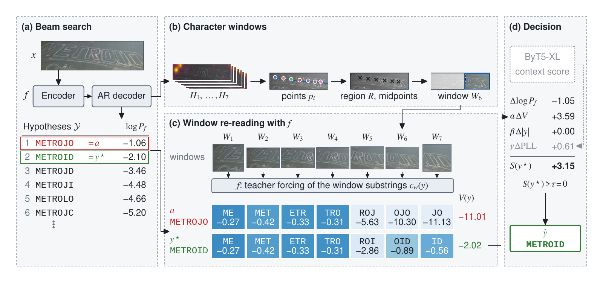

# Character-Window Re-Reading (CWR)

**Training-free N-best rescoring for scene text recognition: the recognizer verifies its own beam hypotheses on
character windows.**

[](LICENSE)


> **Character-Window Re-Reading (CWR): Training-Free N-Best Rescoring for Scene Text Recognition**<br>
> Isaac Kang and Nam Ik Cho, Seoul National University<br>
> Submitted to *IEEE Access* · arXiv: to be added · DOI: to be added

<p align="center"></p>

*Framework of CWR (Fig. 1 of the paper). (a) Beam search keeps the correct METROID but ranks METROJO first. (b) The decoder's
cross-attention locates the characters of the greedy transcript, and a window is cut around each of them. (c) The same
recognizer re-reads every window and scores the part of each hypothesis that falls in it. (d) The window score, the
beam score and the ByT5-XL score select METROID.*

## Method

1. **Beam.** A frozen autoregressive recognizer (SVTRv2-AR, public weights) returns its greedy transcript *a* and the
   top 10 hypotheses of a beam search.
2. **Character windows.** Its decoder cross-attention locates each character of *a*; the window of position *i* covers
   positions *i*−1, *i* and *i*+1 of the text region, and its boundaries are the midpoints between these positions and
   the next ones (W3 in the paper, `mw3` in the code).
3. **Window re-reading.** The same recognizer scores, by teacher forcing, the substring of every hypothesis that falls
   in each window; the overlap-weighted sum (weights ω_w) is the window score *V(y)*.
4. **Decision.** The window score is combined with the beam score, a length term and the ByT5-XL pseudo-log-likelihood
   (PLL); another hypothesis replaces *a* only when its combined score exceeds that of *a* by more than τ. No model is
   trained: the coefficients are selected once on 10,000 validation images of Union14M-L-val, none of them identical to
   an evaluation image.
5. **Optional image-conditioned extension.** A frozen Qwen3.5-27B-GPTQ-Int4 judges whether the text is occluded,
   handwritten or spelled nonstandardly, and the coefficients change for those images.

**Paper ↔ code.** α = `omega` (window), β = `beta` (length), γ = `mu` (ByT5-XL), τ = `tau`; the window score *V(y)* is
`W` in the window tables and its weights ω_w are `u_w`; the windows W1 · W3 · W5 · W7 · W9 of the paper are `--window
mw1` · `mw3` · `mw5` · `mw7` · `mw9`.

```
S(y) = Δb(y) + α·ΔV(y) + β·(|y| − |a|) + γ·ΔPLL(y)          (Δ: value of y minus value of a)
output = argmax_y S(y) if that score > τ, else a             (α 0.4 · β 1 · γ 0.1 · τ 0)
```

## Results

<!-- results:begin -->
<!-- generated by tools/maintenance/release_readme_results.py from LEGIT-paper 716f86535efeb2625fd53343c6e3698f349260b3 -- do not edit -->

**SVTRv2-AR on the common benchmarks (CB) and Union14M-Benchmark (UB)** (paper, Table 3). The recognizer is the public UnionST checkpoint; ByT5-XL adds 3,738 M parameters.

| Method | Params (M) | IIIT5K | SVT | IC13 | IC15 | SVTP | CUTE80 | **CB avg** | Curve | Multi-Oriented | Artistic | Contextless | Salient | Multi-Words | General | **UB avg** |
|---|---:|---:|---:|---:|---:|---:|---:|---:|---:|---:|---:|---:|---:|---:|---:|---:|
| Greedy | 22.5 | 99.47 | 98.92 | 99.30 | 92.44 | 96.90 | **100.00** | 97.84 | 95.42 | 97.22 | 86.67 | 89.60 | 91.09 | 91.99 | 87.74 | 91.39 |
| Beam | 22.5 | 99.47 | 98.92 | 99.30 | 92.55 | 96.90 | **100.00** | 97.85 | 95.51 | 97.22 | 86.89 | 89.73 | 91.28 | 91.99 | 87.87 | 91.50 |
| Beam + re-read | 22.5 | 99.50 | 98.76 | 99.30 | 92.32 | 97.05 | **100.00** | 97.82 | 95.80 | **97.37** | 87.11 | 90.76 | 91.03 | 92.96 | 87.88 | 91.84 |
| Beam + ByT5 | 22.5 + 3,738 | 99.43 | 98.92 | **99.42** | **92.88** | 98.29 | **100.00** | 98.16 | 95.67 | 97.08 | 87.00 | 89.86 | 90.84 | 92.96 | 87.85 | 91.61 |
| **Beam + re-read + ByT5 (ours)** | 22.5 + 3,738 | **99.53** | **99.07** | 99.30 | **92.88** | **98.45** | **100.00** | **98.21** | **95.92** | 97.30 | **87.33** | **91.14** | **91.47** | **93.93** | **88.06** | **92.17** |

**Five recognizers, each with its own windows** (paper, Table 6; CB and UB averages). Adding the window term to ByT5-XL rescoring raises the UB average by 0.36–0.56 points on every recognizer.

| Configuration | SVTRv2-AR<br>CB | SVTRv2-AR<br>UB | TRBA<br>CB | TRBA<br>UB | PARSeq<br>CB | PARSeq<br>UB | MDiff4STR<br>CB | MDiff4STR<br>UB | SVTRv2-CTC<br>CB | SVTRv2-CTC<br>UB |
|---|---:|---:|---:|---:|---:|---:|---:|---:|---:|---:|
| Default output | 97.84 | 91.39 | 95.72 | 84.92 | 96.64 | 88.05 | 97.25 | 88.38 | 96.58 | 86.19 |
| Beam | 97.85 | 91.50 | 95.99 | 85.29 | 96.55 | 88.09 | 97.12 | 88.97 | 96.51 | 86.25 |
| Beam + re-read | 97.82 | 91.84 | 95.91 | 85.58 | 96.74 | 88.88 | 97.46 | 89.85 | 96.58 | 87.00 |
| Beam + ByT5 | 98.16 | 91.61 | 96.56 | 86.66 | **97.25** | 89.29 | **97.67** | 89.72 | **97.52** | 87.93 |
| **Beam + re-read + ByT5 (ours)** | **98.21** | **92.17** | **96.58** | **87.06** | **97.25** | **89.76** | 97.63 | **90.21** | 97.47 | **88.29** |

**Image-conditioned extension on SVTRv2-AR** (paper, Table 8; key rows). WOST / HOST: weak / heavy OST occlusion, ORT: occluded text, GNHK: handwriting, CHAOS: nonstandard spelling; these columns are accuracy over their crops.

| Configuration | CB avg | UB avg | WOST | HOST | ORT | GNHK | CHAOS |
|---|---:|---:|---:|---:|---:|---:|---:|
| Beam | 97.85 | 91.50 | 91.80 | 84.85 | 27.93 | 81.18 | 81.27 |
| Beam + ByT5 | 98.16 | 91.61 | **93.92** | 87.54 | 33.85 | 84.00 | 61.76 |
| Beam + re-read + ByT5 (fixed combination) | 98.21 | **92.17** | 93.38 | 86.51 | 31.88 | 82.59 | 73.17 |
| **+ image-conditioned coefficients (all three branches)** | **98.22** | 92.08 | 93.63 | **87.79** | **34.27** | **84.61** | **87.51** |

Word accuracy (%) as reported in the paper (LEGIT-paper commit `716f86535e`): ASCII letters and digits, case-insensitive (`tools._io.normalize_36_paper`); CB and UB averages are macro averages over their sets. Bold: highest value in each column among the rows shown.
<!-- results:end -->

## Installation

Python 3.11. Run every command from the root of this tree (the recognizer config names its character dictionary
relative to it).

```bash
python3.11 -m venv .venv && . .venv/bin/activate
pip install torch --index-url https://download.pytorch.org/whl/cu128     # choose the wheel your NVIDIA driver supports
pip install -r requirements.txt
```

Install torch first: `pip install -r requirements.txt` alone installs the newest wheel, which is built for CUDA 13.0
(torch 2.14.1+cu130) and does not run with older drivers such as 535 (CUDA 12.2). Tested: Python 3.11.15,
torch 2.11.0+cu128, transformers 5.20.1, numpy 2.4.6 on an RTX A6000 with driver 535.183.01.

The image-conditioned extension (`--condition`, `judge`) additionally needs vLLM 0.28.0, which brings its own torch.
Use a separate environment for it:

```bash
python3.11 -m venv .venv-judge && . .venv-judge/bin/activate
pip install vllm==0.28.0
pip install -r requirements.txt                 # keeps the torch that vLLM installed
export VLLM_USE_FLASHINFER_SAMPLER=0            # where the FlashInfer sampler cannot be compiled
```

Tested: vLLM 0.28.0, torch 2.13.0+cu129, transformers 5.16.1 on an RTX A6000 with driver 535.183.01.

A C++17 compiler (g++) builds two small kernels on first use (segmentation and curve thinning, in
`~/.cache/legit_rescore/kernels`); without one, the code falls back to scikit-image / Python paths with the same results.

## Model weights

The weights are not redistributed. Download them from their providers; their licenses apply.

| model | source | used for |
| --- | --- | --- |
| SVTRv2-AR, `UnionST-U14MFilter.pth` (97.6 MB, SHA-256 `ef2bfcd29b2b668a971d1d0ffaf3e3cbf304730c41a9b0145d3a946134f6da5a`) | https://huggingface.co/Yesianrohn/UnionST-Models | recognizer: beam, attention, window scores |
| ByT5-XL | https://huggingface.co/google/byt5-xl | PLL; downloaded by `transformers` on first use |
| Qwen3.5-27B-GPTQ-Int4, revision `8f0c09f227ae570e79617c6d9172b59df9c16081` | https://huggingface.co/Qwen/Qwen3.5-27B-GPTQ-Int4 | condition judge (`--condition`, `judge` only) |

```bash
hf download Yesianrohn/UnionST-Models UnionST-U14MFilter.pth --local-dir weights
export LEGIT_AR_CHECKPOINT=$PWD/weights/UnionST-U14MFilter.pth          # or --checkpoint on every command
hf download Qwen/Qwen3.5-27B-GPTQ-Int4 --revision 8f0c09f227ae570e79617c6d9172b59df9c16081 \
    --local-dir weights/qwen3.5-27b-gptq-int4                           # only for the extension
```

The judge is loaded only after the recognizer and ByT5-XL have been released from the GPU, and vLLM then takes 80 % of
the GPU memory (`judge --gpu-memory-utilization`).

## Quick start (GPU)

```bash
python -m tools.rescore.cli read word1.png word2.png word3.png
```

Each image goes through the beam, the MW3 windows, ByT5-XL and the decision with the manuscript coefficients, and one
JSON line is printed per image:

```
{"image": "word1.png", "greedy": "RONALDO", "output": "RONALDO", "hypotheses": ["RONAIDO", "RONADO", "Ronaldo", ...]}
```

`greedy` is the recognizer's transcript *a*, `output` the rescored result, and `hypotheses` the other beam hypotheses
that were scored. Three images took 21 s on one RTX A6000, most of it loading the models.

### Image-conditioned extension

```bash
python -m tools.rescore.cli read --condition --judge-model weights/qwen3.5-27b-gptq-int4 word1.png word2.png
```

`--condition` adds the image-conditioned extension. The judge is asked only about images whose output can change under
the condition coefficients; the others keep the fixed combination. Each line then has a `route`: `skipped` (no image
condition can change the output; the judge is not asked), `fixed` (asked, no condition met), or `handwriting`,
`occlusion`, `spelling` (the condition whose coefficients were used). If no image needs the judge, the judge model is
not loaded. On 40 heavy-OST images, the judge was asked about 4 (2 `occlusion`, 2 `fixed`) and 36 were `skipped`;
the run took 2 min 19 s on one RTX A6000, including loading the three models.

## Run on a benchmark (GPU, then CPU)

The benchmarks are LMDB stores under `STR_DATA_ROOT` (default `data/openocr` in this tree, e.g. `test/CUTE80`, `u14m/artistic`,
`Union14M-L-val`).

```bash
# beam, windows and ByT5-XL PLL of every image -> run/scores.jsonl (resumes by key)
python -m tools.rescore.cli score --dataset test/CUTE80 --out run_cute --device cuda:0
# decisions and accuracy with the manuscript coefficients (CPU)
python -m tools.rescore.cli apply --run run_cute --out outputs.jsonl
# image-conditioned extension: judge answers for the images that need them (GPU), then the decisions (CPU)
python -m tools.rescore.cli judge --run run_cute --out judge.jsonl --model weights/qwen3.5-27b-gptq-int4
python -m tools.rescore.cli apply --run run_cute --condition judge.jsonl --out outputs_condition.jsonl
# choosing the coefficients again: score the validation images, then run the grid (CPU)
python -m tools.rescore.cli score  --dataset Union14M-L-val --keys char-window-rereading-data/benchmarks/validation-keys.txt --out run_val --device cuda:0   # the 10,000 validation images (keys in the data archive below)
python -m tools.rescore.cli select --run run_val --out coef.json
python -m tools.rescore.cli apply  --run run_cute --coef coef.json
```

`score` stores everything the decision needs, so `select` and `apply` run without a GPU. The defaults are the setting
of the manuscript: beam width 10 with 10 characters expanded per hypothesis, cached keys / values, TF32 matmuls on
Ampere or newer GPUs, the W3 windows of the paper (`--window mw3`; `mw1` · `mw5` · `mw7` · `mw9` are the W1–W9 widths,
`w3` is an earlier segment-window definition that the paper does not use), and ByT5-XL in bfloat16. The setting is
stored in the run protocol, so runs of different settings never mix. `python -m tools.rescore.cli --help` lists the remaining options (CPU-side window preparation on a
separate machine, batch sizes).

## Reproduce the paper's tables (CPU)

The stored inputs (beam lists and window scores of the five recognizers, ByT5-XL PLL tables, judge answers), the validation
set and the reference result files are published as one archive, `char-window-rereading-data.tar.gz` (0.98 GB, 2.26 GB
unpacked), attached to [release v1.3](https://github.com/isaac-kang-ISPL/char-window-rereading/releases/tag/v1.3) of this
repository. Its
`README.md` lists the parts, and `MANIFEST.json` every file with its size and SHA-256. In the recorded files of the
archive, absolute paths and host names are removed or made relative (the changed keys are listed in its `README.md`);
values are unchanged.

```bash
# unpack; the folder is the data root as it is
tar xzf char-window-rereading-data.tar.gz
export LEGIT_DATA=$PWD/char-window-rereading-data
```

The reproduction runs on the CPU and needs only numpy, scipy, scikit-image, pyyaml, lmdb and pillow
(`pip install numpy scipy scikit-image==0.26.0 pyyaml lmdb pillow`; torch, transformers and OpenCV are not imported).
`python -m tools.experiments.rescore.reproduce --list` shows the stages; those whose inputs are not in the archive are
marked and are not run.

```bash
python -m tools.experiments.rescore.reproduce --out repro \
    --only table_main,table_condition,table_recognizers,table_intervals,recorded
```

The command recomputes the accuracy values of Tables 3, 4, 6 and 8 of the paper and the paired bootstrap intervals of
Tables 4 and 6 from the stored inputs (`tools/experiments/rescore/paper_tables.py`) and compares the four result files with
the reference copies of the archive byte for byte; it exits non-zero when a file differs. On one CPU core the five stages
took 260 s with an empty cache and a peak memory of 12 GB (Python 3.11.15, numpy 2.4.6; the first run builds a
content-keyed cache in `~/.cache/legit_rescore`).

- **`table_main`** (Tables 3 and 4) selects α, β, γ and τ on the 10,000 validation images (`benchmarks/validation-set.json`
  of the archive) and applies them once to CB + UB (414,482 images). `repro/reference/paper_tables/main.json` holds the
  coefficients and, for the greedy transcript, Beam, Beam + re-read, Beam + ByT5 and Beam + re-read + ByT5, the accuracy of
  each of the 13 sets, the CB and UB averages, and the images each rescored row corrects and breaks against Beam.
- **`table_condition`** (Table 8) decides every image of CB, UB and the five specialized sets (weak and heavy OST, ORT,
  GNHK, CHAOS) with fixed coefficients (the rows of Table 4 and the tuple selected on all development data of the
  extension), with each condition branch alone and with all three branches (`tools/rescore/condition.py`, the stored
  answers of Qwen3.5-27B-GPTQ-Int4 in `judge/answers.jsonl.gz` for the 119,922 images whose output can change with the
  condition coefficients; every other image keeps the fixed output), and with routing by the dataset name.
  `repro/reference/paper_tables/condition.json` holds the CB and UB averages and the correct images of the five sets for
  every row. The stage needs neither a GPU nor vLLM; `cli judge` produces the answers for new images.
- **`table_recognizers`** (Table 6) repeats `table_main` for TRBA, PARSeq, MDiff4STR and SVTRv2-CTC: each recognizer's
  greedy output and beam list (top 10 hypotheses; PARSeq and MDiff4STR also re-read their refinement outputs), the window
  scores of its own MW3 windows (built from its attention and transcript and read by itself), α, β, γ and τ selected on the
  validation images, and the five rows on CB + UB. `repro/reference/paper_tables/recognizers.json` holds the coefficients
  (also listed in the supplementary material), the per-set accuracy and the CB and UB averages; the SVTRv2-AR column of
  Table 6 is `main.json`.
- **`table_intervals`** (Tables 4 and 6) recomputes the outputs of the rows with the coefficients of `main.json` and
  `recognizers.json` and gives paired bootstrap 95 % intervals of the CB and UB macro-accuracy differences: the three
  rescored rows of Table 4 against Beam, and for every recognizer the full row against its Beam and its Beam + ByT5. The
  images of each set are resampled with replacement with both outputs of an image kept together (10,000 replicates,
  percentile interval, a fixed seed per comparison). `repro/reference/paper_tables/intervals.json` holds the intervals and,
  per set, the images each comparison corrects and breaks.
- **`recorded`** checks the recorded files of the archive (timings, run records, published results) by SHA-256.

The coefficients of the image-conditioned extension (branch
thresholds and coefficients, and the tuple selected on all its development data) were selected on development data that
are not in the archive; the release applies them as recorded in `tools/rescore/condition.py` and `paper_tables.py`.

### Scope of the release

The release reproduces the accuracy values of Tables 3, 4, 6 and 8 and the bootstrap intervals of Tables 4 and 6. It does
not include the code or inputs of the other experiments of the paper and its supplementary material: the additional input
controls (Table 7), the other bootstrap intervals of the supplementary material, the experiments of the supplementary
material, and the timing runs. Timing and memory measurements and
the published results of other methods were produced in the research repository; this release verifies their recorded
outputs by SHA-256 (`recorded`) instead of recomputing them.

### Reproduction notes

- **Python version.** The result files were written with Python 3.11. From 3.12 on, `sum()` adds floats with
  compensation, so a CB / UB average can differ in its last digit (about 1e-14). Correct-image counts and the selected
  coefficients do not change.
- **CPU.** The result files were written on an AVX-512 machine. On an AVX2 machine, a few values can differ in the last
  digit because numpy and OpenBLAS pick other kernels; `reproduce --portable` makes numpy skip its AVX-512 kernels and
  OpenBLAS use its Haswell kernels. Counts, decisions and table values do not change.
- **bf16.** ByT5-XL runs in bfloat16, so its PLL values depend slightly on the GPU type, the library versions and how
  the masked inputs are grouped into batches. Every ByT5-XL value read by the manuscript tables was computed on NVIDIA
  A100-SXM4-80GB GPUs (torch 2.13.0, transformers 5.16.1): the main table in 16 fixed shards (strings of equal length
  batched together, about 3,072 masked rows per batch), and the strings added later (under 0.5 % of the SVTRv2-AR
  lookups) in separate runs on the same GPU type and software. To match the manuscript tables byte for byte, use the
  released PLL table through `reproduce`, not a recomputation; `tools.rescore.lm.run_shards` reproduces the shard
  split, which narrows but does not remove the difference on another GPU (median 0.02 nat for 3,000 strings on an
  RTX A6000). Recomputed on another GPU or with other batches, a string's PLL moves by 0.1–0.2 nat in the median
  (99th percentile below 1 nat; 0.16 and 0.98 for `cli score` on an RTX A6000), and the selected string changes on
  about 0.1 % of the images or fewer: 1 of 1,187 CUTE80 and U14M Artistic images with `cli score`, none of 1,000
  timing images on an RTX 3090 and on an RTX A6000, and 276 of the 414,482 CB and UB images (net −6 correct, 275 of
  them in U14M General) when the whole table is replaced by an FP32 recomputation. With the manuscript coefficients
  (`apply` without `--coef`), the CB and UB averages of the final combination moved by at most 0.03 percentage points in
  these checks (0.06 for Beam + ByT5); one CUTE80 image is 0.06 points of the CB average. Choosing the coefficients again on the validation set after a
  recomputation can land on a neighboring grid point (3 of 8 simulated recomputations), which moved the averages by
  up to 0.17 points, so keep the manuscript coefficients when comparing with the paper.
- **Window scores.** The recognizer's window scores also depend slightly on the GPU and on how the windows are
  batched; the reproduction reads the stored window scores and is unaffected.

## Repository structure

```
.
├── assets/                     figure of this README
├── openrec/                    recognizer code (from OpenOCR)
├── strtrain/                   configuration loader and character dictionary
├── tools/
│   ├── rescore/                the method: beam, character windows, window scores, ByT5 PLL, decision, CLI, judge
│   │   └── data/               SVTRv2-AR configuration, glyph offsets, font metrics
│   └── experiments/rescore/    reproduce.py and the stages of Tables 3, 4, 6 and 8
├── tests/test_rescore_core.py  unit tests (CPU)
├── requirements.txt
├── LICENSE, NOTICE
├── DATA_FILES.json             stored inputs that the reproduction reads (path, size, SHA-256)
└── manifest.json               every file of the release with its SHA-256 and source commit
```

| path | role |
| --- | --- |
| `tools/rescore/cli.py` | command-line entry point: `read` (image files), `score` / `select` / `apply` (benchmarks), `judge` |
| `tools/rescore/nbest.py` | SVTRv2-AR greedy transcript and beam search (GPU) |
| `tools/rescore/position.py`, `region.py`, `midpoint.py`, `window.py` | character points from the attention maps, the text region, MW3 midpoint windows, window crops |
| `tools/rescore/segment.py` | segments of an earlier window definition (`--window w3`; not used in the paper) |
| `tools/rescore/window_score.py` | window scores and their overlap-weighted sum V(y) (GPU) |
| `tools/rescore/lm.py` | ByT5 pseudo-log-likelihood (GPU) |
| `tools/rescore/hypotheses.py`, `decide.py` | candidates (a and the beam top 10) and the decision rule S(y) > τ |
| `tools/rescore/select.py` | coefficient grid and selection on the validation set |
| `tools/rescore/condition.py` | image-conditioned extension: judge prompt, routing, per-condition coefficients |
| `tools/rescore/metrics.py` | CB / UB word accuracy and per-image correctness |
| `tools/rescore/store.py` | locations of the stored inputs under the data root |
| `tools/experiments/rescore/` | `reproduce.py` and its stages: Tables 3, 4, 6 and 8 and the intervals of Tables 4 and 6 (`paper_tables.py`), recorded files (`recorded.py`) |

## Environment variables

| variable | meaning | default |
| --- | --- | --- |
| `LEGIT_AR_CHECKPOINT` | SVTRv2-AR checkpoint `UnionST-U14MFilter.pth` | none in a release; set it or pass `--checkpoint` |
| `LEGIT_DATA` | data root: the unpacked data archive (`beams/`, `windows/`, `pll/`, `benchmarks/`, `judge/`, `recorded/`, `reference/`) | this tree |
| `LEGIT_RESCORE_OUT` | where the experiments write their results | the data root |
| `STR_DATA_ROOT` | LMDB benchmarks (`test/<set>`, `u14m/<set>`, `Union14M-L-val`, …) | `data/openocr` in this tree |
| `LEGIT_RESCORE_CACHE_DIR`, `LEGIT_RESCORE_CACHE` | cache of the stored tables; `0` turns it off | `~/.cache/legit_rescore`, `1` |
| `LEGIT_RESCORE_KERNEL_DIR` | where the C++ kernels are built | `~/.cache/legit_rescore/kernels` |
| `LEGIT_SEGMENT_BACKEND` | `skimage` forces the scikit-image watershed, `cpp` stops if the kernel cannot be built | automatic |
| `LEGIT_AR_KV`, `LEGIT_AR_TF32` | `0`: no cached keys / values, fp32 matmuls in SVTRv2-AR | `1`, `1` |
| `VLLM_USE_FLASHINFER_SAMPLER` | `0` where vLLM cannot compile the FlashInfer sampler (judge only) | vLLM default |

Tests: `python -m pytest tests/test_rescore_core.py` (CPU, about 1 s; one test is skipped without the research tree).

## Citation

```bibtex
@article{kang2026charwindow,
  title   = {Character-Window Re-Reading ({CWR}): Training-Free N-Best Rescoring for Scene Text Recognition},
  author  = {Kang, Isaac and Cho, Nam Ik},
  journal = {IEEE Access},
  note    = {submitted},
  year    = {2026}
}
```

## License

The code is released under the Apache License 2.0 (`LICENSE`). `openrec/` is taken from
[OpenOCR](https://github.com/Topdu/OpenOCR) (Apache License 2.0); `tools/rescore/compact_watershed.cpp` ports the
compact watershed of scikit-image (BSD-3-Clause, `tools/rescore/compact_watershed.LICENSE`). Model weights and
datasets are not included and remain under the licenses of their providers.

## Acknowledgments

The recognizer code comes from [OpenOCR](https://github.com/Topdu/OpenOCR), and the SVTRv2-AR checkpoint from the
UnionST authors ([Yesianrohn/UnionST-Models](https://huggingface.co/Yesianrohn/UnionST-Models)). The method also uses
[ByT5-XL](https://huggingface.co/google/byt5-xl) and, for the extension,
[Qwen3.5-27B-GPTQ-Int4](https://huggingface.co/Qwen/Qwen3.5-27B-GPTQ-Int4). The segmentation kernel ports the compact
watershed of [scikit-image](https://scikit-image.org).
